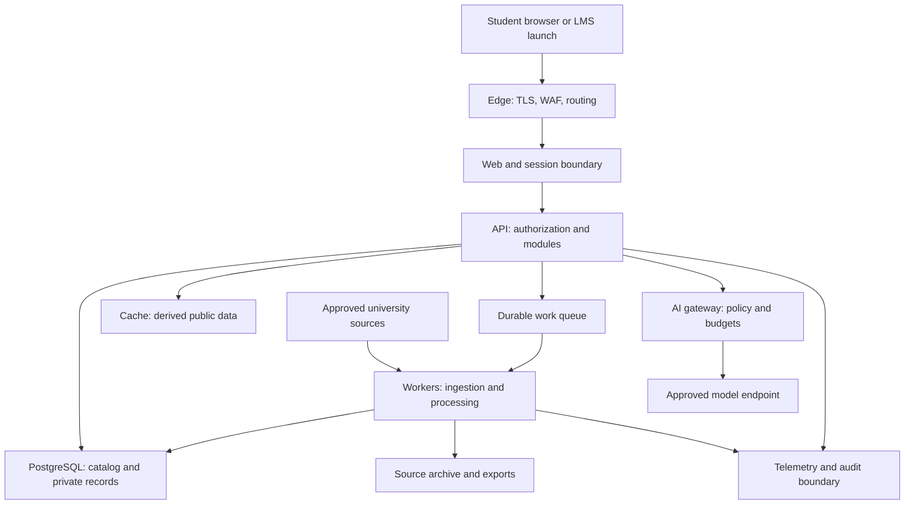
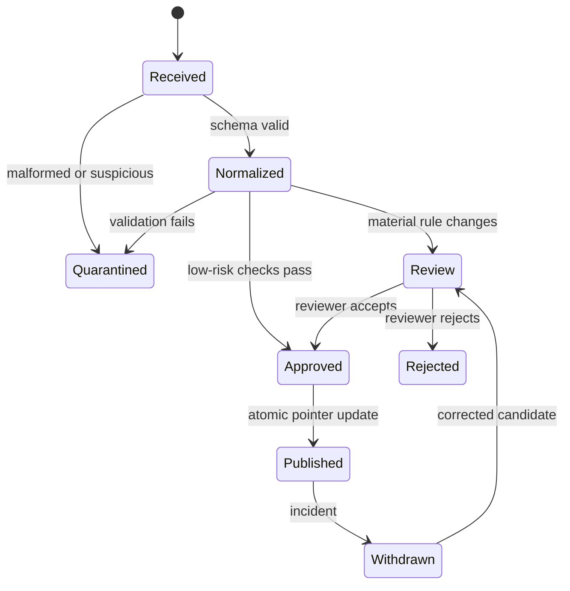

# Academic Navigator: Master Architecture and Delivery Plan

Version 1.0 | 28 September 2026 | Status: proposed implementation baseline

Audience: founder, engineering lead, security/privacy reviewers, university IT, and Codex implementation agents.

This document defines what to build, the boundaries that must hold, and the evidence required before release. It is a design, not evidence of implemented controls, proven capacity, institutional approval, or compliance certification. All numerical operating targets below are proposed project requirements to be validated. “Must” denotes a release requirement; “should” denotes a recommendation that can be changed through a documented architecture decision.

## 1. Executive decision

Build Academic Navigator as a modular application with three independently deployable workloads: web, API, and background workers. Use PostgreSQL as the authoritative application store, an immutable source archive for public academic data, a deterministic rules package, and an optional AI explanation layer. Make tenant isolation, evidence capture, and operational visibility part of the first working slice.

The initial production deployment should use managed infrastructure in an approved Canadian region. Package the application as OCI containers and keep institutional integrations behind versioned interfaces. Add dedicated university deployments through repeatable infrastructure modules. Universities with different infrastructure receive the same application release and institution-specific configuration, rather than separate code forks.

The first production scope is course discovery, prerequisite assessment, prerequisite paths, published offerings, manually entered course history, and source-backed explanations for a defined Waterloo course subset. Expand coverage after validating the rules. Full degree auditing, registration, grade writeback, and automated academic decisions remain separate future projects.

The platform must continue to provide search and deterministic results when the language model is unavailable. It must stop producing affirmative assessments when required evidence is missing, invalid, or beyond the permitted freshness window.

### Corrections to the earlier proposal

- Technical feasibility is still subject to a real data-access and rule-coverage spike. A proposal and public documentation do not establish operational feasibility.
- Course IDs attached to an identifiable account are personal academic information. Grades, programs, free-text questions, and enrollment can increase sensitivity.
- Passing published prerequisites does not guarantee registration. Seats, reserves, restrictions, standing, timing, and institutional decisions may still prevent enrollment.
- An LTI launch authenticates a launch context. It does not grant access to Quest, transcripts, or arbitrary LMS records.
- A canonical model makes expansion easier, but every institution still requires source mapping, rule validation, identity configuration, privacy review, and operational onboarding.
- “50,000 users” needs a workload definition. This design targets 50,000 registered users initially; it does not claim 50,000 simultaneous active users.

## 2. Delivery tiers and release boundaries

| Tier | Permitted scope | Required evidence before release |
|---|---|---|
| A: local engineering | Synthetic student profiles; approved public-source fixtures | Repeatable local setup, deterministic tests, no production credentials |
| B: independent student beta | Public academic data; optional accounts and self-entered academic history | Privacy notice and retention settings, account isolation, deletion, backups, alerting, security review, academic benchmark |
| C: institutional pilot | Approved SSO/LTI, limited institutional cohort | Institutional sponsor, source rights, risk/privacy review, deployment agreement, LTI tests, named operational owners |
| D: restricted records | Authorized student-system data, potentially grades and standing | Explicit institutional authorization, approved data flow and contracts, independent penetration test, record-level authorization, verified restore/deletion, private integration controls |
| E: multi-institution service | Additional universities and deployment profiles | Adapter contract suite, tenant isolation suite, per-institution policy and data sign-off, reproducible deployment and upgrade evidence |

Build the security architecture for Tier D from the start. Enable its data connectors only after its gate passes. Progress on public-data functionality can continue while institutional approvals are pending.

## 3. Workload, performance, and reliability contract

### 3.1 Initial capacity model

Use the following synthetic reference workload until real usage replaces these assumptions:

| Dimension | Initial qualification target |
|---|---|
| Registered users | 50,000 in one institution |
| Daily active users | 10,000 during a planning period |
| Simultaneously active sessions | 2,000 at peak |
| API interaction rate | One request per active session per 10 seconds, or 200 requests/second sustained |
| Burst | 500 API requests/second for 15 minutes |
| Traffic distribution | 55% course/search reads, 25% assessments, 15% profile/plan operations, 5% assistant requests |
| AI arrival rate | 10 turns/second at sustained peak; 25/second in the burst scenario |
| Course history | Up to 200 entries per user for load qualification, or 10 million entries |
| Academic dataset | 100,000 versioned course records and 1 million offering/meeting rows as a stress fixture; not a claim about Waterloo's actual size |
| Multi-tenant test | Three synthetic institutions, including identical course codes and external user IDs |

At 10 AI turns/second and 15 seconds average turn duration, approximately 150 concurrent turns are in flight. At 25/second, approximately 375 are in flight. A turn may make multiple model calls. Qualify token-per-minute, request-per-minute, and connection limits using the actual prompt and tool-call distribution. Application autoscaling cannot remove a provider quota limit.

Run arrival-rate load tests, not only closed-loop tests that slow down as the server slows. Include realistic think time for browser scenarios, cold and warm caches, a mix of profile sizes, login bursts, long-lived streaming connections, background ingestion, and a noisy tenant. Record the exact image, dataset, cloud size, connection limits, and generator configuration with every result.

### 3.2 Service-level objectives

| Capability | Initial production target | Measurement |
|---|---|---|
| Core search, profile, assessment | 99.9% successful valid requests over 30 days | Edge and API counters, plus synthetic student journeys |
| Core server latency | p95 under 500 ms; p99 under 1.5 s at qualified sustained load | Server duration, separately reported by route |
| Rules computation | p95 under 200 ms for a supported single-course assessment | Engine span; excludes network and model calls |
| Assistant | 99.5% successful accepted turns; p95 first useful output under 5 s and completion under 25 s | Separate assistant SLI including provider failures |
| Incident detection | Critical synthetic or service failure detected within 5 minutes | Fault-injection exercise and alert timestamps |
| Operational recovery | RPO at most 15 minutes; RTO at most 4 hours for a regional recovery event | Measured restore into an approved recovery environment |
| Catalog refresh | Attempt every 24 hours, subject to source permission | Last successful fetch, publication age, and source effective dates |
| Published offerings refresh | Attempt every 6 hours, subject to source permission | Feed age and source availability |

The 99.9% time-equivalent budget is about 43 minutes in a 30-day month; the actual core SLI is request-based. Track planned maintenance and internal dependency failures. Separately report invalid requests, security blocks, quota rejections, and platform overload; do not disguise overload as client misuse to improve the SLI.

No live seat-availability promise in v1. Show publication timestamps. A future seat feed needs a separately agreed freshness contract and must still avoid guaranteeing registration.

Targets are not contractual SLAs until the release has passed qualification and operations can support them. A 24-hour response promise requires a staffed escalation arrangement. A solo founder can operate a limited beta with stated support hours; institutional production needs explicit coverage.

## 4. Logical architecture and trust boundaries



The public network, session/API boundary, data stores, university source systems, model provider, and operations environment are separate trust boundaries. Define permitted inbound and outbound connections in infrastructure code. Deny public database access. Keep cloud metadata endpoints, arbitrary internet URLs, and private institutional networks inaccessible to assistant tools.

### 4.1 Concrete technology baseline

| Area | Baseline | Decision rationale |
|---|---|---|
| Web | Next.js with TypeScript, accessible React components | Student and administration interfaces in one maintained web application |
| API | Python FastAPI; Pydantic contracts; SQLAlchemy and Alembic | Fits the founder's Python background and keeps ingestion and rules in one language |
| Rules | Pure Python package without framework, network, or database dependencies | Deterministic behavior, property testing, independent benchmarking |
| Persistence | Supported PostgreSQL release; full-text search; pgvector only for approved public content | Transactional consistency and initial search needs in one operational system |
| Cache | Redis-compatible managed cache where justified | Public course responses, short-lived coordination, rate limits; never the sole record store |
| Work dispatch | Azure Service Bus in the reference deployment; queue port in application code | Durable delivery, retry and dead-letter workflows |
| Object store | Azure Blob in the reference deployment | Source snapshots, build evidence, and authorized exports |
| Telemetry | OpenTelemetry SDKs and Collector; Azure Monitor reference backend | Standard application instrumentation with replaceable storage/export |
| Identity | Maintained OIDC provider; university OIDC/SAML through an identity broker where needed | Avoid implementing password management or SAML parsing in application code |
| Provisioning | Terraform, immutable OCI images, Docker Compose for local development | Reproducible managed deployments and a simple local workflow |
| Delivery | GitHub Actions baseline, transferable scripts for GitLab CI | Pipeline logic remains runnable outside the CI vendor |

During Phase 0, pin supported runtime, framework, extension, action, and container versions after checking maintenance status, licensing, security notices, and managed-service compatibility. Record them in an ADR and lockfiles. This plan deliberately does not invent version compatibility guarantees.

Use one API codebase with explicit modules. Split a module into a network service only when measured scaling, isolation, ownership, or release needs justify it. Web, API, ingestion workers, and AI execution can scale independently without turning every domain into a service.

### 4.2 Module boundaries

| Module | Owns | Must not do |
|---|---|---|
| Identity and tenancy | External identity mapping, memberships, session policy | Infer privileges from email suffix or arbitrary client tenant IDs |
| Catalog | Institution, course versions, offerings, source provenance | Read student grades to answer public searches |
| Rules | Versioned AST evaluation and explanation traces | Call a model to determine whether a rule passed |
| Student records | Self-reported courses; later authorized imports | Merge self-reported and official values silently |
| Planning | Saved goals and candidate paths | Certify graduation or promise enrollment |
| Search | Institution-scoped retrieval and ranking | Retrieve private records into a shared vector collection |
| Assistant | Intent, constrained tool orchestration, grounded explanation | Execute arbitrary SQL, URLs, code, or privileged actions |
| Integrations | Source adapters, identity/LTI bindings, future SIS adapters | Put institution-specific logic throughout the core |
| Operations | Data health, jobs, incidents, feature controls | Grant ordinary operators routine access to student records |
| Audit | Durable security and administrative evidence | Become an unrestricted copy of prompts, tokens, or grade data |

### 4.3 Reference Azure deployment

Provision Azure Front Door with WAF for approved public ingress, Azure Container Apps for web/API/worker workloads, Azure Database for PostgreSQL Flexible Server for the database, Blob Storage for objects, Service Bus for jobs, Key Vault for secrets/keys, Container Registry for images, and Azure Monitor behind the OpenTelemetry Collector for diagnostics. This is the selected reference mapping, subject to Phase 0 regional/SKU and budget verification. Add a managed Redis-compatible cache only when a measured use case warrants it.

Keep the API internally reachable from the web/session layer; expose only explicitly needed routes such as registered LTI endpoints through controlled ingress. Restrict direct origin access so the WAF cannot be bypassed. Use private connectivity to stateful services, managed workload identities, environment-specific vaults, and restricted service endpoints. Configure health/readiness probes, graceful shutdown, rolling-drain time and streaming timeouts explicitly. Liveness must not restart every replica merely because an upstream data source is unavailable.

Set a warm minimum of two web/API replicas for production and benchmark a bounded autoscaling maximum. Size the database and pools from the reference load test rather than assuming a particular SKU will meet it. Reserve capacity for deployment overlap, ingestion, audit writes and failover. Capture all chosen SKUs, limits, provider quotas, network paths and resource costs in a deployment manifest before the capacity gate.

## 5. Multi-university deployment strategy

Define an institution as a data/governance entity and a tenant as an access and policy boundary. An institution may have multiple pilot or production deployments. Map these explicitly; do not assume domain name, email address, academic institution, and deployment are interchangeable.

Use deployment stamps: independently provisioned copies of the application stack serving a defined tenant set. This is an established deployment pattern [S7]; the following isolation policies are project decisions.

| Profile | Use | Isolation and responsibility |
|---|---|---|
| Shared regional SaaS | Independent beta and approved lower-sensitivity tenants | Shared compute/database with tenant and subject isolation, per-tenant quotas and restricted operators |
| Dedicated managed stamp | Default proposal for a university supplying confidential student records | Dedicated database, queues, storage, keys, identities and network boundary; operator-managed upgrades |
| University cloud subscription | Institution controls its cloud accounts and connectivity | Same images, university secrets and identity, contract-defined vendor access and operations |
| University-hosted deployment | Institution requires its own infrastructure | Helm profile on a supported Kubernetes environment, approved PostgreSQL, object storage, queue and telemetry adapters; university operates infrastructure |

Azure is the first tested profile. AWS and university-hosted profiles are future deliverables, not current supported deployment claims. Build one alternate profile before marketing portability. A second institution and an alternate hosting profile test different things; validate both.

Application ports must cover identity validation, object storage, queue operations, secrets/key use, model invocation and telemetry export. Preserve common semantics for acknowledgments, retry, visibility/lock renewal, checksums, encryption and deletion. Run adapter contract tests against actual services before declaring a profile supported. Do not hide materially different guarantees behind a generic interface.

Keep university-specific source parsers, grading scales, term mappings and policy settings in versioned adapters/configuration. Use capability flags such as `supports_grade_threshold`, `supports_offerings`, and `supports_lti_launch`; unsupported capabilities produce explicit UI states.

A small provisioning registry can track deployment region, tenant routing, release version and service health. It must not centralize academic histories, credentials or unrestricted cross-tenant support access. Dedicated installations must continue operating if a central registry is unavailable.

### Tenant isolation controls

- Resolve tenant membership server-side from a verified session or registered institutional launch. A tenant supplied in a path/header is only a requested context, never proof of access.
- Use tenant-scoped primary/unique keys and composite foreign keys where needed to prevent cross-tenant references. A user record must also enforce subject ownership or an explicit scoped grant.
- Apply PostgreSQL RLS to private tenant tables as defense in depth. The application role must not own tables or have `BYPASSRLS`; use `FORCE ROW LEVEL SECURITY` where appropriate. Keep migration credentials separate. PostgreSQL explicitly documents owner/superuser bypass behavior [S5].
- Set authorization context transaction-locally using trusted server code. Test pooled connection reuse across tenants and subjects; never leave tenant state on a pooled session. RLS does not neutralize a compromised application role that can forge its own context, so parameterized queries and service boundaries remain essential.
- Enforce the same boundaries in queues, object keys, signed downloads, caches, search indexes, exports, analytics and worker jobs. A storage prefix alone is not authorization.
- Run cross-tenant and same-tenant/different-student negative tests for every private endpoint and job type.
- Default to dedicated stamps for restricted institutional records. Shared deployment of those records requires an explicit institution-approved exception and evidence supporting its isolation model.

## 6. Academic data model and publication pipeline

### 6.1 Authoritative entities

| Domain | Required entities and important fields |
|---|---|
| Institution | Institution, tenant, deployment, source configuration, capability manifest |
| Academic catalog | Course identity, alias/cross-list relation, course version, calendar version, effective dates, units as exact decimal |
| Offerings | Term, offering, section, meeting, local timezone, publication status |
| Requirements | Rule set, expression AST, original text, parser version, review status, supported features |
| Provenance | Source record ID/URL, fetched timestamp, content hash, source effective date, snapshot ID, validation result |
| Student data | Subject, tenant membership, course attempt, completion/in-progress state, evidence origin, optional approved grade and scale |
| Evaluations | Result ID, profile version, snapshot bundle, engine version, policy version, trace, creation time |
| Integration | External identity mapping, LTI registration/deployment, source cursor, import job |
| Operations | Audit event, outbox event, job lease/state, data incident, deletion request, policy configuration |

An external course code is not a global primary key. Preserve renamings, equivalencies, repeat attempts, transfer-credit uncertainty and effective dates. A grade must carry its grading scheme and attempt context. Do not compare letter grades and numeric grades without an approved institutional mapping.

Separate identity/contact fields from academic history and public catalog data. Do not store grade fields until the restricted-data gate is approved. Database constraints, schemas and retention schedules must distinguish public snapshots from private records.

Use `valid_from`/`valid_to` for academic applicability and recorded timestamps for what the platform knew when. Calendar year, student cohort and offering term may select different rules. The application must ask for missing context or return unknown; it must not silently use the newest calendar for every student.

### 6.2 Publication state machine



1. Fetch with explicit source credentials, allowlisted hosts, rate limits, timeouts and bounded size. Retain authorized public raw snapshots with checksums. Never substitute an error/login page for catalog content.
2. Normalize into staging. Source fixtures and parsers are versioned together. If an LLM helps parse text, its output remains an untrusted candidate requiring validation and appropriate review.
3. Validate schema, identity consistency, referential integrity, duplicates, deleted records, term mappings, missing rules, graph anomalies and parser coverage.
4. Compare with the current publication. As initial tunable thresholds, quarantine a course-count drop above 5%, a rule-text change affecting more than 10% of a source set, or a parser-coverage decrease above 2 percentage points. A threshold breach requires investigation, not automatic rejection forever.
5. Publish only a coherent version bundle. Database catalog rows, rule sets and search indexes must carry compatible version IDs. Swap the active pointer atomically after all required parts are ready.
6. Run synthetic known-answer evaluations against the new publication. Roll back or disable affected rule evaluations if the results fail.
7. Retain the prior public snapshot and an incident trail so the team can explain and reproduce the change.

New or semantically changed supported rules require academic review before their first affirmative assessments. Begin with a small reviewed Math/CS subset. Other courses may remain searchable with original requirements and an explicit “assessment unavailable” state. A human reviewer must understand academic rules; parser-generated tests alone do not establish accuracy.

### Source freshness and failure behavior

Proposed catalog policy: warning after 48 hours without successful refresh; after 7 days, block affirmative automated assessments unless an authorized reviewer has confirmed the applicable source is unchanged. Proposed offerings policy: warning after 12 hours; suppress definitive “offered next term” conclusions after 48 hours without confirmation. These policies must be adjusted to actual source publishing cadence and institutional agreement.

Display both academic effective dates and retrieval times. A source can be recently fetched but academically outdated. An unpublished future schedule means “not yet published,” not “not offered.” A feed omission means unknown unless the source contract guarantees completeness.

Schema changes, repeated fetch failures, unexpected deletions, quarantine growth, and missed scheduled jobs must generate operational events. Preserve the last verified source for browsing with clear freshness status. Never silently promote partially imported data.

Waterloo's Open Data v3 exists and uses API registration [S1]. Its support repository states there is no explicit v3 license [S2]. Confirm reuse, redistribution, commercial use, request limits and caching rights with the source owner before public/commercial launch. Do not assume public Kuali interfaces are stable or authorized bulk APIs. Phase 0 must establish a permitted Calendar access method or approved export. If unavailable, use approved curated fixtures and reduce scope.

## 7. Deterministic rule engine

### 7.1 Contract

The engine accepts a versioned rule AST, a versioned student fact set, the target term/calendar context, and evaluation policy. It returns a structured result with one of `SATISFIED`, `NOT_SATISFIED`, or `UNKNOWN`, plus an explanation tree and evidence references. Enrollment feasibility is a separate result and is normally `NOT_EVALUATED` in v1.

Supported AST concepts should include `all_of`, `any_of`, `at_least_n`, `course_completed`, `minimum_grade`, `units_completed`, `program_membership`, `academic_level`, `concurrent_enrollment_allowed`, `prohibited_credit`, and `manual_permission`. Implement and qualify these incrementally; the presence of a type in the schema does not imply production support.

Use three-valued logic:

| Expression | Result |
|---|---|
| AND: any false | NOT_SATISFIED |
| AND: all true | SATISFIED |
| AND: otherwise | UNKNOWN |
| OR: any true | SATISFIED |
| OR: all false | NOT_SATISFIED |
| OR: otherwise | UNKNOWN |

For `at_least_n`, return true once known satisfied children reach n; false only if even all unknown children could not reach n; otherwise unknown. Unsupported clauses are unknown. Negation preserves unknown. Manual permission is unknown unless an authorized, scoped, unexpired approval exists.

An omitted course is only known missing if the student has confirmed the supplied history is complete for the question. Otherwise return “not recorded” with uncertainty. A completed course with a missing grade cannot pass a minimum-grade check. In-progress courses must not be treated as completed except where the official rule expressly permits concurrency.

Antirequisites, repeat credit and restrictions require their own semantics. Taking another course can sometimes create a restriction, so do not assume global monotonicity. Apply monotonic property tests only to positive prerequisite fragments where that property is valid.

### 7.2 Example result shape

The following identifiers and rule are synthetic, not Waterloo course facts:

```json
{
  "evaluation_id": "ev_example",
  "institution_id": "demo-university",
  "course_id": "COURSE-300",
  "assessment": "UNKNOWN",
  "registration": "NOT_EVALUATED",
  "profile_version": 7,
  "snapshot_bundle": "demo-catalog-v3",
  "engine_version": "rules-v1",
  "policy_version": "demo-policy-v1",
  "findings": [
    {"code": "COURSE_COMPLETED", "course_id": "COURSE-200", "state": "SATISFIED"},
    {"code": "GRADE_UNAVAILABLE", "course_id": "COURSE-200", "state": "UNKNOWN"}
  ],
  "evidence": [{"source_record_id": "src-example", "rule_path": "requirements.0"}],
  "limitations": ["Program restriction has not been verified"]
}
```

Make the badge, reasons and source panel render directly from this structure. Use deterministic templates for consequential statements. The LLM may add explanation, but cannot change the badge or convert unknown into eligibility.

For prerequisite graphs, preserve OR branches, exclusions and unresolved nodes. Put limits on traversal depth and node count, detect cycles and return a partial graph with an explanation. A displayed path is a candidate prerequisite path, not a proof of an optimal graduation plan.

### 7.3 Academic quality gate

Start with at least 300 independently reviewed synthetic and permitted source-based cases covering the initial scope. Include AND/OR nesting, grade thresholds, program/level restrictions, missing context, course renaming, corequisites, antirequisites, repeat attempts, transfer credits and effective-date changes. Expand the corpus whenever a defect appears.

Require 100% expected-result agreement on the accepted supported corpus and zero known false-positive SATISFIED results before release. Report unsupported coverage separately, weighted by student usage and by course count. These are test gates, not proof of perfect real-world accuracy. Any confirmed false affirmative triggers an incident, regression case, and suspension of the affected rule family until fixed.

## 8. API, transactions, and asynchronous reliability

Define OpenAPI schemas before implementing routes. Proposed first routes:

| Route | Behavior |
|---|---|
| `GET /v1/institutions/{id}/courses` | Public scoped search, bounded filters and cursor pagination |
| `GET /v1/institutions/{id}/courses/{courseId}` | Versioned public record and sources |
| `GET /v1/me/course-history` | Authorized subject history |
| `PUT /v1/me/course-history` | Validated replacement with optimistic concurrency |
| `POST /v1/assessments` | Assessment using server-resolved identity and versioned facts |
| `POST /v1/assistant/turns` | Creates a bounded assistant turn; returns its authorized stream/job reference |
| `GET /v1/admin/data-health` | Tenant-scoped source and publication health |
| `POST /v1/admin/publications/{id}/approve` | Review action with reason, authorization and audit |
| `POST /v1/me/deletion-requests` | Creates a tracked deletion workflow |

Use stable machine-readable error codes, safe human messages and a correlation ID. Support `409` for stale profile versions, `429` with retry guidance for quotas, and explicit partial/unknown assessment states. Restrict payload size, filters, sort fields, page size, graph expansion and chat history length. Use exact decimal units and timezone-aware timestamps.

Private writes use optimistic concurrency (`If-Match` or explicit version). Idempotency keys are scoped to tenant, subject, operation and payload hash; retries must not duplicate imports, exports or administrative operations.

Commit state changes and outbox events in one database transaction. Deliver outbox events at least once. Workers use deduplication keys, bounded retries with jitter, poison-message dead-lettering, renewable leases, checkpoints and explicit terminal states. A crashed worker must be safe to resume. Do not promise exactly-once processing.

Carry trace context and tenant/job identifiers in the envelope; carry sensitive data by restricted reference rather than raw queue payload. Validate authorization and job scope again when the worker executes. Job acknowledgments occur only after durable outcomes. Provide a reviewed replay operation that cannot override permissions or silently duplicate side effects.

## 9. AI and retrieval boundary

The assistant is optional and read-only in v1. It can call a fixed tool set: catalog search, course lookup, assessment, prerequisite graph, published offerings, and source retrieval. Every tool enforces identity, tenant, subject scope, input schema and result limits in server code.

Public catalog text can use full-text and embedding search. Do not put grades, histories, transcripts, private chats or institutional secrets into a shared vector database. A later private retrieval feature requires its own record-level ACL design, deletion propagation and threat model.

Treat retrieved text, course descriptions, source HTML and student messages as untrusted content. They cannot redefine tools, authorize access, or alter system policy. Allowlist retrieval hosts, revalidate redirects and resolved addresses, and block private IP ranges and metadata endpoints to prevent SSRF.

Send the minimum approved information to the model. Default behavior sends public course facts and an assessment summary without names, student numbers, raw grades or a full history. Free text may itself contain personal data: apply minimization and redaction, explain the processing, and disable external AI for tenants without an approved provider/data policy. Redaction does not guarantee anonymization.

Configure model endpoint, region/processing terms, allowed data classes, token budget, tool-call maximum, timeout and daily tenant spend cap. Do not silently fail over to a provider or region the institution has not approved. Confirm provider retention, abuse monitoring, training-use terms and subprocessors contractually before private processing.

Set a bounded turn budget, initially no more than 4 tool calls and 30 seconds, subject to measured usability. Handle provider 429s, timeouts and partial streams. Reserve budget before expensive work. Once streaming begins, avoid automatic retries that duplicate content or billing.

The UI source panel must be assembled from actual tool evidence IDs. Validate any model citation against those IDs. Test fabricated citations, source contradictions, prompt injection, cross-tenant requests and attempts to reveal system credentials. Model or prompt changes are release changes with a fixed evaluation corpus and canary rollout.

## 10. Identity, security, and privacy controls

### 10.1 Authorization model

| Principal | Allowed access |
|---|---|
| Anonymous visitor | Published public catalog and nonpersistent public questions within quotas |
| Student | Own records, own saved plans, own evaluations |
| Advisor, future | Explicitly assigned students and permitted fields for a stated purpose and duration |
| Data steward | Public source review and rule publication; no routine private student access |
| Tenant administrator | Tenant integrations, users/roles and aggregate operations; no blanket academic-history access |
| Platform operator | Service health and deployment operations; no routine academic-history access |
| Auditor | Approved audit metadata scope; access to record content only through separately authorized investigation |

Use role plus attributes: tenant, subject relationship, purpose, permission scope, validity period, and data classification. Default deny. MFA is required for privileged users; prefer phishing-resistant methods. Step-up authentication is required for sensitive administrative actions. Break-glass access requires a ticket/reason, narrow scope, expiry, audit, notification and subsequent independent review. An emergency path is not a shared superuser account.

Use secure, HttpOnly cookies; appropriate SameSite settings; CSRF protection; exact CORS origins; session rotation on login/privilege change; idle and absolute expiry; logout/revocation. Do not store long-lived access tokens in browser local storage. Maintain authorization inside the API even when the web layer authenticates requests.

### 10.2 Security baseline

Adopt a versioned OWASP ASVS Level 2 applicability matrix, with selected higher-assurance controls for privileged and student-record paths [S3]. Map delivery practices to NIST SSDF [S4]. These are verification frameworks, not automatic certification.

Required implementation controls include:

- TLS for external and internal service connections, encryption at rest, managed keys, key rotation and recovery procedures. Use per-stamp keys for dedicated institutions. Select field encryption for high-impact identifiers and private connector tokens through threat review; do not invent cryptography.
- Workload identities for cloud access and CI federation; no long-lived cloud keys in repositories. Secret scanning, secret-manager access logs, scoped credentials, tested revocation.
- Parameterized database queries, output encoding, strict content-security policy, safe Markdown rendering without arbitrary HTML, dependency minimization and restricted egress.
- WAF and per-user/per-tenant rate limits, body-size bounds, upload prohibition in v1, bot/abuse controls that do not rely solely on shared campus IP addresses.
- Separate development, staging and production accounts/resources. Synthetic staging records. No production database copied to laptops or preview deployments.
- Non-root containers, minimal images, read-only filesystem where feasible, no privileged runtime, narrowly mounted secrets and explicit network policies.
- Inventory of services, data assets, dependencies and owners; software bill of materials for each release; signed release artifacts and provenance.

Threat modeling must cover account takeover, insecure object access, cross-tenant leakage, malicious source records, rule poisoning, prompt injection, SSRF, replayed LTI launches, SQL/XSS injection, operator misuse, queue replay, backup theft, supply-chain compromise and denial-of-wallet attacks.

### 10.3 Retention, deletion and governance

Proposed defaults below require privacy-owner and institution approval before use with personal data:

| Data | Proposed default |
|---|---|
| Public catalog snapshots | 24 months, subject to source permission and reproducibility needs |
| Account/course history | Until deletion or 12 months inactivity, with notice and institution-specific exceptions |
| Raw chat | No persistent storage by default; an approved opt-in history feature may retain 30 days |
| Redacted diagnostic logs/traces | 30 days; no raw prompts, grades, credentials or course histories |
| Security/audit metadata | 365 days in protected storage, subject to applicable record obligations |
| Backups | 35-day rolling retention; longer only with an approved reason |
| Temporary authorized exports | At most 24 hours; authenticated download and short-lived access links |

Implement export/correction/deletion workflows with identity verification, status tracking and a manifest of affected stores. Target deletion from active systems within 30 days unless a documented legal/institutional obligation requires retention. Propagate to caches, derived artifacts, model-related stores and subprocessors as applicable. Backups expire on their published schedule; a restored backup must replay deletion tombstones before service resumes. Legal holds are narrowly authorized, time-reviewed and disclosed as required.

Audit records should identify actions and scoped subjects without retaining the deleted content. Protect re-identification mappings and document lawful retention exceptions. Reproducibility lasts only as long as the required personal evidence is authorized to be retained; do not promise permanent replay of deleted student data.

For a Waterloo institutional deployment, obtain privacy/legal review of applicable Ontario obligations and data-processing responsibilities. The IPC publishes public-sector PIA guidance and states that FIPPA institutions must conduct PIAs before collecting personal information [S9]. The independent startup's obligations, later jurisdictions, contractual role and breach procedures require separate determination. Canadian hosting alone does not establish compliance. Logs, support access, backups, identity, AI processing and subprocessors all belong in the data-flow review.

## 11. LTI and private university integrations

Implement LTI 1.3 launch only after the core product works. Use a maintained, reviewed implementation/library and test against the 1EdTech specifications and an LMS test environment [S10]. Do not implement JWT/OIDC cryptography from scratch.

Store each trusted platform issuer, client ID, registered JWKS location, allowed redirect/target URLs, deployment IDs and institution mapping. Validate signature, algorithm allowlist, issuer, audience and authorized party where applicable, expiry, nonce/state, message type, version, and deployment binding. Enforce short validity and one-time use of launch state. JWKS refresh must be bounded and restricted to registered locations.

Map users using the validated issuer/client/subject context and deployment membership. Do not use email matching to silently link accounts. Account linking requires a verified flow proving control of both identities. LMS roles do not automatically map to platform administration privileges.

Test multiple registrations and deployments, reused subjects across platforms, key rotation, replay, forged claims, disabled users, absent optional identity fields, logout and browser cookie restrictions. Support an approved top-level/new-window launch if embedded sessions cannot work safely. Never relax origin, CSRF or cookie protections to make an iframe demo succeed.

D2L documents registration, deployment and link configuration [S11]. Waterloo currently requires a distinct required pedagogical use case and an information risk assessment for non-central LEARN integrations, with requests at least two months ahead [S12]. An academic-planning tool's fit with that pedagogical criterion is an open adoption question. Keep a university website or standalone SSO pilot available as another entry point.

Future SIS/Quest integrations are read-only by default, institution-approved, least-privilege and separately credentialed. Establish source identity matching, completeness, authoritative fields, delta/snapshot semantics, deletions, correction handling, freshness and reconciliation. Quarantine conflicting identities or grades; never silently overwrite authoritative records with self-reported values. No automated enrollment or grade writes under this plan.

## 12. Observability: what each operator can establish

Observability must cover user-visible behavior, source-data quality, security and business correctness. An HTTP 200 response with an incorrect academic assessment is a product failure.

### 12.1 Instrumentation contract

Every request/job must carry a server-generated correlation ID and propagated trace context. Record service/release, environment, deployment, bounded tenant identifier, route template, outcome code, duration and relevant snapshot/parser/engine versions. Use an opaque evaluation ID for support; do not emit the evaluated student facts to general logs.

OpenTelemetry provides a standard instrumentation path. Its sensitive-data guidance reinforces limiting and sanitizing captured telemetry [S6]. Disable automatic capture of bodies, cookies, authorization headers, query text and SQL parameter values. Use an allowlist of fields, redaction at source and collector, and sentinel tests that inject fake sensitive values and verify their absence from every sink.

Keep metrics low-cardinality: route templates, service, deployment, result class and bounded source names. Never put user IDs, course codes, prompts, evaluation IDs or arbitrary URLs into metric labels. Use controlled logs/traces for detailed investigation. Use bounded collector tail sampling to retain error/slow traces and approximately 5% of normal traces; configure upstream sampling and collector capacity accordingly, because a collector cannot recover spans already discarded by an SDK. Document behavior when telemetry capacity is exceeded. Security audit events are never sampled.

### 12.2 Required dashboards

| Dashboard | User | Questions it must answer |
|---|---|---|
| Service health | Engineer/on-call | Which route/deployment failed, when, on which release, and which dependency is responsible? |
| Data health | Engineer/data steward | Which feed is stale, quarantined, incomplete, or changed schema? What publication is live? |
| Academic quality | Data steward/product owner | Which rules are supported, unknown, disputed or withdrawn? Did a release change expected results? |
| Tenant operations | University administrator | Is our deployment healthy? Are imports running? Which capabilities are enabled? Who changed settings? |
| Security | Security owner | Which privileged actions, denials, unusual exports or identity failures require investigation? |
| AI and cost | Engineer/product owner | Provider latency/limits, cost per successful turn, rejected turns, citation failures and fallback use |

The administration UI must show last attempted and last successful import, source effective date, live snapshot, diff summary, review queue, failures, owner, incident link and runbook. Provide safely scoped retry/quarantine/rollback/feature-disable actions with confirmation and audit. Display aggregate student usage without exposing personal records or small cohorts that enable re-identification.

### 12.3 Alert and ownership matrix

| Signal | Initial rule | Response owner/action |
|---|---|---|
| Core availability | Synthetic journey fails in two independent probes; fast/slow SLO burn alerts | On-call engineer investigates or rolls back |
| Error-budget burn | Page at 14.4x burn over both 1 h and 5 min; slower ticket at 6x over 6 h and 30 min | Tune for volume; freeze risky releases when budget exhausted |
| Missing data job | No success for twice configured cadence | Data engineer; show stale status |
| Parser drift | Publication threshold breach or new unsupported clause | Data steward; quarantine and review |
| Wrong affirmative assessment | Confirmed case, regardless of rate | Incident lead; disable affected family and assess impact |
| Queue health | Oldest critical job over 5 min or any new dead-letter message | Engineer investigates; bounded replay |
| Audit delivery | Durable spool age over 5 min or integrity check failure | Security/on-call; block sensitive actions if durable recording is impossible |
| DB pressure | Sustained pool wait, disk risk, replication lag or backup failure | Engineer; reduce pressure, scale or recover |
| AI saturation/spend | Approved budget thresholds at 70%, 90%, and hard cap | Product/operator; rate limit and deterministic fallback |
| Isolation anomaly | Any detected cross-tenant access or unexpected privileged export | Security incident; contain affected access immediately |

Alerts must include tenant/deployment scope, first occurrence, release, safe correlation links, impact summary, owner and runbook. Deduplicate and route by severity. Test the notification path with drills; a configured alert that reaches no responsible person does not satisfy the requirement.

### 12.4 Separate audit stream

Audit authentication events, access/denials to restricted records, exports, role grants, source approvals, rule overrides, integration changes, feature disables, administrative reads and break-glass actions. Capture actor/service, tenant, action, scoped object ID, purpose/ticket, decision, timestamp, correlation ID and relevant versions. Avoid raw record contents and secret values.

Write critical state-change audit events transactionally through the outbox. For sensitive reads/exports, durably record authorization/access intent before releasing data, then outcome. If durable evidence cannot be recorded, fail closed for privileged changes and private exports/reads covered by that policy; public catalog reading may continue.

Export to append-only protected storage with separately administered retention controls and integrity verification. Database logs alone are insufficient against a privileged operator. Access to audit evidence is itself audited. Test spool exhaustion, collector outage, tampering, time synchronization and recovery.

### 12.5 Example incident walkthrough

A source changes its prerequisite field. The adapter schema check fails; the candidate enters quarantine; the last publication remains active. The data-health board identifies the source, failed field, parser release and affected course count. The on-call engineer receives a safe trace and runbook. Students see freshness status, and affirmative assessments stop when the policy expires. After a parser fix, benchmark validation and steward approval, publication switches atomically. A before/after record documents the fix. This behavior is an acceptance test, not just an operational description.

## 13. Availability, recovery, and degraded operation

| Failure | Required behavior |
|---|---|
| Language model unavailable | Search, structured course pages, rules and templated explanations continue |
| Academic source unavailable | Serve last approved public data with freshness status; apply expiry policy |
| Cache unavailable | Use bounded database fallback; preserve quotas through an approved alternate limiter or safely reduce service |
| Database unavailable | Fail private operations safely; do not acknowledge uncommitted writes; separately cached public pages may remain available |
| Queue unavailable | Keep committed outbox work pending with visible delay; do not imply job completion |
| One worker crashes | Lease expires and another worker resumes idempotently |
| Tenant identity provider unavailable | Existing valid sessions follow expiry policy; no bypass login; public browsing remains available |
| Telemetry backend unavailable | Bounded local buffering; audit uses its own durable path; alert through an independent monitor |
| Region outage | Recover only into an approved location following tested DR steps |

For production, use at least two web/API replicas and an HA database configuration where the selected region/SKU supports the required availability. Verify actual zone support and failure domains during provisioning. Set connection-pool maxima so maximum replicas times pool size, plus workers and headroom, stays below the tested database limit. Autoscaling must not create a connection storm.

Use point-in-time database recovery, protected object versions, secret/key recovery and infrastructure-as-code. Back up configuration, source version pointers, identity/LTI mappings and audit evidence as well as application rows. Choose recovery regions with the institution; do not enable unrestricted cross-border replication.

Perform monthly isolated restore checks and quarterly full recovery exercises before and during institutional production. Verify checksums, relational integrity, representative evaluations, RLS, identity mappings, deletion replay, secrets, audit continuity and measured RPO/RTO. Backup success is not evidence of restore success.

Runbooks: bad release; incorrect academic rule; source outage/schema change; suspected data breach; compromised secret; failed identity/LTI launch; database restore; queue backlog; AI provider failure; deletion/export failure; expired certificate; university offboarding.

For a data-quality incident, identify affected evaluation IDs by snapshot and engine version, restrict access to the impacted-student mapping, correct the data, and follow the agreed notification policy. For a security/privacy incident, preserve evidence, contain access, involve the institution's designated contacts, and follow counsel-approved notification obligations. Do not hard-code one legal notification deadline for every jurisdiction.

## 14. Scaling and cost controls

Scale web/API on measured concurrency, latency, CPU/memory and pool pressure. Scale workers on oldest-job age and queue depth. Keep catalog ingestion and AI work in separate worker pools so a source import cannot consume all interactive capacity. Use per-tenant concurrency and cost budgets to contain noisy neighbors.

Precompute public dependency structures per publication. Cache public course pages and catalog queries with institution, publication, locale and query in the key. Keep authenticated/personalized pages out of shared CDN caches. If private evaluation caching is later needed, include tenant, subject, profile version, rule version and policy version with short retention and explicit invalidation.

Index tenant and subject predicates, course/term lookups, job state and publication joins. Establish query plans and query-count budgets for core journeys; eliminate N+1 reads. Use bounded batched evaluation for “what can I take?” Do not evaluate every catalog course through a separate model call.

If profiling shows database bottlenecks, first fix queries, indexes and pool limits. Add read replicas only for consistency-tolerant public workloads. Partition large append-only audit/evaluation tables after measurements. Add search infrastructure when retrieval latency, quality or operational isolation justifies it. Add stamps when a tenant's load, residency or isolation requirement warrants it.

Expansion qualification points: 100,000 registered users, a second large tenant, then separately defined higher concurrent workloads. A requirement for 50,000 simultaneously active users would need a new capacity model, provider quota plan, distributed load tests, and likely multiple stamps.

Cost model for every environment:

`monthly cost = compute + database/HA + storage/backups + queue/cache + logs/traces + identity + network + AI + security/operations tools`

`AI cost = turns × calls per turn × ((input tokens × input price) + (output tokens × output price))`, using the provider's token billing unit and actual current prices.

Set an approved budget before provisioning production. Track cost per successful planning session and tenant, not just monthly totals. Set telemetry ingestion caps, source archive lifecycle, AI spend controls and nonproduction shutdown schedules. A quota cap should produce a visible fallback, never a mysteriously incomplete answer. Obtain current cloud/provider quotes during Phase 0; this plan makes no unverified dollar estimate.

## 15. Verification plan and release evidence

| Test layer | Required coverage | When |
|---|---|---|
| Static checks | Type/lint/format, dependency direction, schema validation | Every PR |
| Rules unit/property tests | Truth tables, uncertainty, boundaries, applicable properties, deterministic replay | Every PR |
| Academic benchmark | Independently reviewed expected outcomes and explanations | Rule/parser/data changes; before publication |
| Real database integration | Migrations, RLS, constraints, transactions, outbox, pooled-connection context | Every relevant PR |
| Adapter contracts | Fetch/normalize/checkpoint/retry/deletion/term mapping, malformed fixtures | Adapter changes and scheduled upstream check |
| Authorization | Every role/action/resource combination; cross-tenant and cross-student negatives | Every private API/job change |
| API contracts | OpenAPI compatibility, limits, errors, idempotency, optimistic concurrency | Every API change |
| Browser E2E | Search, history, unknown result, source link, deletion, admin review | Every release; core smoke per PR |
| Accessibility | Automated checks plus keyboard/screen-reader review; text alternative to graphs | UI changes; manual review before beta |
| AI evaluation | Grounding, citation validity, unsupported requests, injection, information disclosure | Prompt/model/tool changes |
| Security automation | SAST, secrets, dependency/container/IaC scanning, staging DAST | PR/build/nightly as appropriate |
| LTI/SSO | Positive/negative launch matrix, replay, identity collision, key rotation, browser behavior | Integration changes and pilot gate |
| Load/soak | Defined workload, cold caches, 2-hour sustained, 15-minute burst, 24-hour soak | Capacity gate and material performance changes |
| Fault injection | Dependency outages, worker crash, partial import, lease expiry, dead-letter replay | Before production and quarterly |
| Privacy | Export/delete propagation, restored-backup tombstones, telemetry sentinel tests | Data-path changes and periodic review |
| Independent security assessment | Penetration testing focused on auth, tenancy, LTI and records | Before restricted institutional data; after major boundary changes |

Target WCAG 2.2 AA for the product and document automated and manual findings [S8]. This target supports accessibility engineering; it does not itself settle every institutional/legal accessibility requirement.

Do not use coverage percentage as the sole acceptance test. Aim for at least 90% branch coverage in the rules core, while requiring all identified decision paths and security invariants to have meaningful tests. Use mutation testing for consequential boolean logic. Expected results must not be generated by the same parser being evaluated.

Scans block known exploitable critical/high findings. A false positive or exceptional risk acceptance needs a named reviewer, evidence, compensating controls and expiry; Codex cannot accept its own security exceptions. Track vulnerabilities through remediation, rather than treating a green scanner as proof of safety.

## 16. CI/CD and CloudOps

### Pull request pipeline

1. Install from locked dependencies; validate formatting, types, module boundaries and documentation/config schemas.
2. Run relevant unit/property tests and real PostgreSQL integration tests, including tenant/subject isolation.
3. Validate migration compatibility and OpenAPI changes; run academic fixtures when rule/data code changes.
4. Run secrets, SAST, dependencies, licenses, container and infrastructure checks.
5. Build the image once, record its digest, generate an SBOM and provenance, and sign the release candidate.
6. Run core browser and telemetry-sentinel checks against an isolated environment with synthetic data.

### Release pipeline

1. Promote the same signed image digest to staging. Apply the reviewed infrastructure plan and backward-compatible migration.
2. Run smoke, security/authorization, synthetic journey and applicable performance checks.
3. Attach a release manifest: commit, images, dependencies/SBOM, migration IDs, config version, rules/parser version, compatible source schema, test evidence and rollback instructions.
4. Require the designated human reviewer for production. Protect branches and environments; CI identities receive only their environment's permissions.
5. Use canary or blue/green rollout, initially 5% then 25% then 100% where supported. Observe error, latency and unknown-result changes. Security defects or incorrect rule assertions trigger rollback/disable immediately.
6. Record deployment evidence and watch the agreed observation window. Data publication has its own approval/promotion process.

Use expand/migrate/contract database changes. Add compatible schema first, deploy readers/writers that tolerate both versions, backfill with resumable jobs, then remove old structures in a later release. Rolling back application code must remain possible across the supported schema window. Destructive migrations need a specific recovery plan; do not assume reversing SQL restores lost data.

Manage infrastructure through reviewed code and remote, encrypted, access-controlled state. Detect drift, prohibited public endpoints, missing encryption/backup settings, absent tags and broad IAM grants. Separate state by environment/stamp. Private deployments use an approved release registry/mirror and have an agreed upgrade and vulnerability-remediation process.

Operations cadence: daily automated feed/backup/security health checks; weekly incident/cost/data-quality review; monthly access, restore and dependency review; quarterly DR, incident and tenant-isolation exercise. Assign a primary and backup owner to every service, source, alert and runbook.

## 17. Compliance and audit evidence package

Maintain a control register with `control_id`, requirement/source, applicability, implementation location, owner, test/evidence link, reviewer, review date, status, and exception expiry.

The institution-facing package must include:

- System inventory, architecture and data-flow diagrams, trust boundaries and threat model.
- Data inventory/classification, purposes, lawful authority/responsibilities as determined by counsel, retention/deletion schedule and approved processing locations.
- PIA/risk-assessment inputs, provider/subprocessor register, contracts and source permissions.
- Access-control matrix, privileged access records, periodic access reviews and key-management procedures.
- ASVS applicability/evidence mapping, penetration-test findings and remediation records.
- Secure-development policy, SBOM/provenance, release/change history and dependency-response process.
- Source quality benchmarks, publication approvals, academic incident history and unsupported-rule coverage.
- SLO reports, alert drills, backup/restore and DR results, incident response and escalation contacts.
- Accessibility assessment and known limitations.
- Offboarding/data portability procedure, service responsibilities and support/maintenance agreement.

SOC 2 or ISO 27001 may become commercial requirements. Pursue them only with defined scope, accountable operations and qualified external assessment. This architecture cannot confer either status. Use “designed against these controls” until evidence and independent assessment justify a stronger statement.

## 18. Repository structure and developer experience

Use a single repository initially with the following ownership boundaries:

| Path | Contents |
|---|---|
| `apps/web/` | Student UI, administration UI, server-side session boundary |
| `services/api/` | HTTP routes, application orchestration, authorization |
| `services/worker/` | Job dispatch, lifecycle, source and AI execution |
| `packages/domain/` | Canonical types and business invariants |
| `packages/rules/` | Pure evaluator and explanation traces |
| `packages/adapters/` | Waterloo/public sources, queue/object store, identity and model adapters |
| `contracts/` | OpenAPI, event schemas, AST schemas, capability manifests |
| `db/` | Schema migrations, RLS policies and synthetic seed data |
| `tests/` | Golden academic cases, integration, authorization, E2E, load, fault and AI suites |
| `infra/` | Reference cloud modules, environment configuration, local Compose; later Helm profile |
| `ops/` | Dashboards, alerts, SLO definitions, runbooks and disaster recovery |
| `docs/` | Master plan, ADRs, threat model, control register, data dictionary and progress ledger |
| `.github/workflows/` | Thin CI/CD orchestration calling repository scripts |

Offer documented commands such as `make bootstrap`, `make dev`, `make test`, `make test-integration`, `make test-security`, `make test-e2e`, `make seed-demo` and `make verify`. Implement the commands before referencing them as working. Local setup must use synthetic identities and records; live-source tests are separately opted into with server-side secrets.

Use generated API clients from OpenAPI so Python and TypeScript agree on transport contracts. Domain logic lives in the backend/rules package; the frontend renders results rather than independently reimplementing eligibility.

## 19. Delivery backlog, dependencies and exit gates

Estimates assume one experienced full-time engineer with part-time product/academic review and external security help. Codex may accelerate implementation, but does not remove review, procurement or university response time. Institutional production may take materially longer. The ranges are planning estimates, not a delivery promise.

| Phase | Estimate | Work packages | Exit gate |
|---|---|---|---|
| P0: validate decisions | 1–2 weeks | Data rights/access, sample rules, identity/provider choice, hosting/region/quotas, cost model, threat model, ADRs | Real source feasibility evidence or explicitly reduced fixture-only scope; no unsupported production claims |
| P1: secure foundation | 2–3 weeks | Repo/local setup, CI, tenant/subject model, authentication skeleton, migrations/RLS, telemetry/audit/outbox, source snapshot model | One traced synthetic end-to-end slice with isolation tests and reproducible setup |
| P2: data and rules | 3–5 weeks | Waterloo adapter, staging/quarantine/publication, AST/parser, evaluator, benchmark, freshness logic | Reviewed supported subset; benchmark passes; bad import cannot replace live data |
| P3: student and operations UI | 2–3 weeks | Search, course pages, history, assessments/graphs, sources, data-health/admin review, deletion | Student journeys pass; source incident visible and recoverable; accessibility review |
| P4: assistant | 1–2 weeks | Tool orchestration, provider policy/budgets, citation checks, injection corpus, deterministic fallback | AI cannot widen authorization or overrule assessments; cost and failure behavior verified |
| P5: beta and capacity | 2–4 weeks | Small beta, feedback, bug fixes, reference deployment, load/soak, restore/fault/security exercises | Tier B gate passes; 50k registered-user workload passes on recorded infrastructure |
| P6: institutional pilot | 2–4 engineering weeks plus external approvals | LTI/SSO, independent security work, evidence package, institution review, operational agreement | Tier C approved and actual LMS/SSO test passes |
| P7: restricted records and portability | 4–8+ weeks, separate scope | Authorized SIS adapter, dedicated stamp, restricted-data controls, second institution and alternate deployment proof | Tier D/E gates pass for each enabled capability |

P0–P5 is approximately 11–19 engineering weeks under these assumptions. A course-only prototype can arrive sooner; it must be labeled with its unimplemented production gates. University approval is a separate critical path.

### First ten implementation tickets

| ID | Deliverable | Acceptance condition |
|---|---|---|
| NAV-001 | ADRs and decision register | Technology, source rights, region, identity and initial scope have owners/status |
| NAV-002 | Monorepo and local runtime | Fresh environment starts from documented commands; no real student data |
| NAV-003 | Contracts and canonical schema | Synthetic course/rule/profile fixtures validate; effective-date/version fields exist |
| NAV-004 | Tenant/subject access boundary | Two tenants and two students per tenant pass positive and negative DB/API tests |
| NAV-005 | Telemetry and audit skeleton | One request traces through API/DB/job; privileged action has durable audit evidence; sentinel does not leak |
| NAV-006 | Source snapshot and staging importer | Malformed, partial and duplicate inputs are quarantined or handled idempotently |
| NAV-007 | Publication promotion and rollback | Atomic promotion, version consistency and last-good recovery demonstrated |
| NAV-008 | Minimal rule evaluator | AND/OR/completion/unknown tests pass using synthetic rules; unsupported clauses remain unknown |
| NAV-009 | First student vertical slice | Course lookup → history → assessment → source works with no LLM |
| NAV-010 | First operations vertical slice | Simulated upstream failure produces dashboard state, notification test and documented recovery |

## 20. Codex implementation instructions

Copy this document into `docs/MASTER_PLAN.md` in the project repository. Treat it as the baseline and create an `AGENTS.md` that carries the following rules:

1. Implement one bounded ticket/vertical slice at a time. State its acceptance criteria and relevant security/data boundaries first.
2. Inspect repository instructions and current progress before editing. Preserve existing working code and user changes. Do not substitute mocks for a required production integration without labeling the limitation.
3. Keep `docs/IMPLEMENTATION_STATUS.md` with requirement/ticket ID, status, evidence, gaps and next action. “Designed,” “implemented,” “tested,” and “approved” are different states.
4. Use synthetic students and synthetic or permitted public fixtures. Never fetch or place live student records, secrets, production logs or real grades into prompts, repository examples or test artifacts.
5. Every private route/job must use centralized authorization and have cross-tenant and cross-subject negative tests. Never trust a client-provided tenant, subject or role as authority.
6. Keep the rule engine pure and deterministic. Unknown data or unsupported semantics must never become satisfied by default. AI cannot decide eligibility or supply unvalidated rule facts.
7. Add useful metrics, safe structured events and operational failure behavior with the feature. Never log request bodies, session tokens, raw histories or grades.
8. Add a migration for schema changes and describe upgrade/rollback compatibility. Never modify production state or deploy automatically merely because local tests pass.
9. Run the relevant verification commands; report exact results and skipped/blocked checks. Do not claim tests passed if they were not run.
10. Record meaningful architecture changes in an ADR with alternatives, consequences and any changed acceptance criteria. Do not add infrastructure merely to sound enterprise-ready.
11. Require designated human review for production release, rule semantics/publication, privacy exceptions, privileged-access changes and restricted connectors. Codex cannot approve its own audit evidence or institutional compliance.
12. Finish each ticket with the changed behavior, evidence, limitations, operational impact and next ticket. Stop at the authorized scope of that ticket.

### First prompt to give Codex

> Read `docs/MASTER_PLAN.md` and all repository instructions. Implement Phase P1's first synthetic vertical slice, beginning with NAV-001 through NAV-005 and the minimum synthetic catalog/rule path needed to prove the architecture. Start by recording decisions and unresolved Phase P0 dependencies; do not claim live Waterloo access is validated. Use Next.js/TypeScript, FastAPI/Python and PostgreSQL, with Docker Compose for local development. Establish tenant and subject authorization, transaction-local RLS context, schema migrations, structured redacted telemetry, durable audit/outbox scaffolding, and CI verification. Use synthetic data only. Prove that one student can view their own data, cannot access another student's or another tenant's data, and receives a structured UNKNOWN for an unsupported rule. Make one request traceable end to end without exposing student facts. Keep implementation status and ADRs current, run the relevant tests, and report actual results. Do not implement chat, private university connectors, a cloud production deployment or the entire roadmap in this first slice. If the repository already contains equivalent work, verify and extend it rather than rebuilding it.

This prompt starts development. Subsequent prompts should name the next ticket and its exit criteria. Do not ask Codex to implement the entire system in one unattended change.

## 21. Release checklist and unresolved decisions

### Production acceptance

- A user can search, enter their history, obtain a qualified assessment, inspect its source and understand uncertainty.
- Every supported affirmative result has reviewed rule semantics, valid provenance and permitted freshness.
- Public data failures are detected, quarantined, visible to operators and recoverable without silent corruption.
- Same-tenant/different-student and cross-tenant isolation hold for APIs, DB, jobs, caches, search and exports.
- Sensitive actions have durable audit evidence; telemetry sentinel tests demonstrate redaction.
- The declared workload passes with recorded resource sizing, quotas and costs. Assistant capacity and fallback are separately evidenced.
- Backups have been restored, deletion tombstones replayed, and RPO/RTO measured in an approved environment.
- Alerts reach responsible people; incidents and rollbacks have been rehearsed; support coverage is explicit.
- Security and accessibility findings are resolved or formally accepted with owners and expiry.
- Deployment, rollback, source publication and cloud changes use reviewed repeatable processes.
- Source rights, privacy/data-processing terms and institutional approvals cover the exact enabled capabilities.

### Decision register to resolve before the relevant gate

| Decision | Default proposal | Owner/gate |
|---|---|---|
| Initial academic coverage | Reviewed Waterloo Math/CS subset | Product + academic reviewer, P0/P2 |
| Rights and Calendar access | Confirm permitted API/export and redistribution | Founder + source owner, before live public launch |
| Initial hosting | Azure Canadian region, managed services | Engineering + budget/privacy owner, before provisioning |
| Identity provider | Maintained OIDC provider with approved residency/terms | Engineering + privacy/security, before accounts |
| AI provider/model | Approved endpoint; public facts and minimized summaries only | Engineering + privacy owner, before AI beta |
| Personal-data retention | Proposed schedule in section 10 | Privacy owner/institution, before collection |
| Production spend and support | Approved monthly cap and named escalation owners | Founder/operator, before production |
| Institutional pilot route | LEARN if accepted; standalone SSO/website otherwise | University sponsor/IT, P6 |
| Private grades/SIS | Disabled until explicit authorization and Tier D evidence | University data owner/security/privacy, P7 |
| Compliance claims | Evidence-based statement of implemented controls | Qualified reviewers; never an automatic build output |

## 22. Sources and basis

External sources establish platform capabilities, institutional requirements and verification frameworks. Workload numbers, technology selections, defaults, gates and implementation policies in this document are proposed engineering decisions. Documentation was consulted on 28 September 2026; recheck institutional and legal requirements before deployment.

- **S1. Waterloo Open Data API:** [Official API page](https://uwaterloo.ca/api/) and [live API documentation](https://openapi.data.uwaterloo.ca/api-docs/index.html). Establishes the public API entry point; does not prove every field/source needed by this project is accessible.
- **S2. Waterloo OpenData support repository:** [uWaterloo/OpenData](https://github.com/uWaterloo/OpenData). Basis for requiring explicit confirmation of v3 licensing/reuse.
- **S3. OWASP ASVS:** [Application Security Verification Standard](https://owasp.org/www-project-application-security-verification-standard/). Verification framework for the control register.
- **S4. NIST SSDF:** [SP 800-218, SSDF 1.1](https://csrc.nist.gov/pubs/sp/800/218/final). Secure development practices reference; assess newer guidance when fixing the project baseline.
- **S5. PostgreSQL:** [Row Security Policies](https://www.postgresql.org/docs/current/ddl-rowsecurity.html). RLS behavior, default-deny policy and privileged bypass caveats.
- **S6. OpenTelemetry:** [Handling sensitive data](https://opentelemetry.io/docs/security/handling-sensitive-data/). Telemetry minimization and sanitization guidance.
- **S7. Microsoft architecture guidance:** [Deployment Stamps Pattern](https://learn.microsoft.com/en-za/azure/architecture/patterns/deployment-stamp), [multitenant storage/data](https://learn.microsoft.com/en-us/azure/architecture/guide/multitenant/approaches/storage-data), and [Container Apps scaling](https://learn.microsoft.com/en-us/azure/container-apps/scale-app). Deployment pattern and managed scaling capabilities, not capacity certification.
- **S8. W3C:** [WCAG 2.2](https://www.w3.org/TR/WCAG22/). Product accessibility target.
- **S9. Information and Privacy Commissioner of Ontario:** [Protecting personal information in the public sector](https://www.ipc.on.ca/en/privacy-organizations/protecting-personal-information) and [PIA guide](https://www.ipc.on.ca/en/resources/planning-success-privacy-impact-assessment-guide-ontarios-public-institutions). Institutional privacy-review inputs; applicability must be established for the operating entity and deployment.
- **S10. 1EdTech:** [LTI standard](https://www.1edtech.org/standards/lti), [Security Framework](https://www.1edtech.org/standards/security-framework), and [implementation guide](https://standards.1edtech.org/lti/guides/implementation_guide/implementation-guide). Normative integration references; implementation and certification are distinct.
- **S11. D2L:** [Tool registration, deployment and links](https://community.d2l.com/brightspace/kb/articles/23662-tool-registration-deployment-and-links). Brightspace administrative integration workflow.
- **S12. University of Waterloo:** [Guidelines for integrations between LEARN and non-centrally supported tools](https://uwaterloo.ca/educational-technology-hub/catalogs/centrally-supported-tools/guidelines-integrations-between-learn-and-non-centrally). Use-case, information-risk review and request-lead-time requirements.
